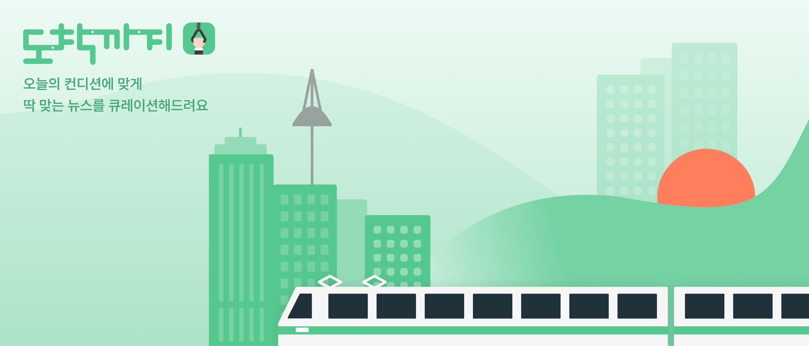
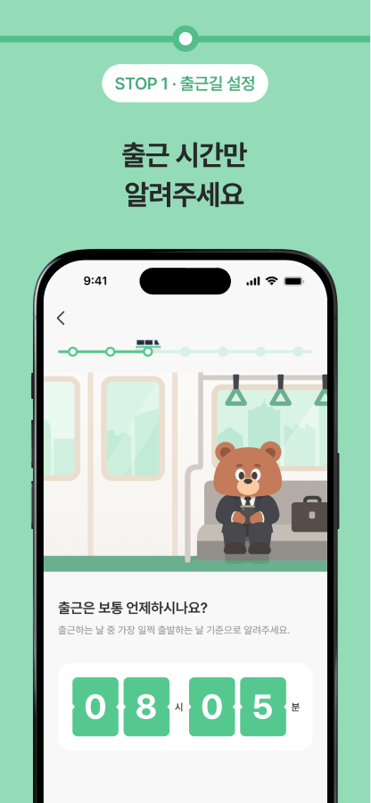
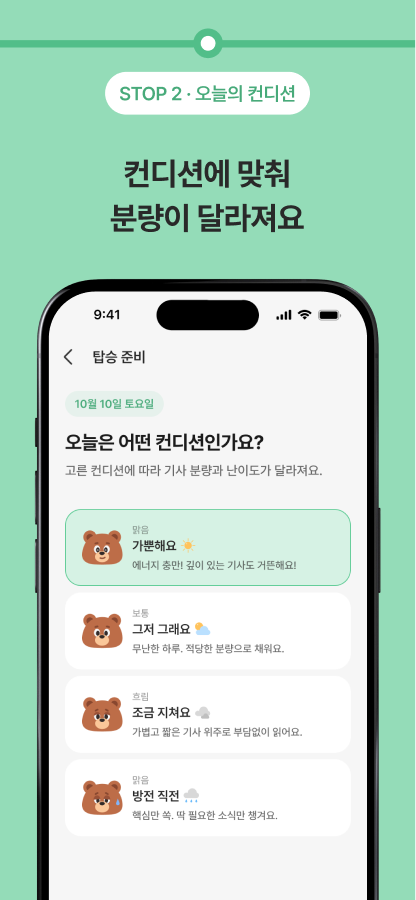
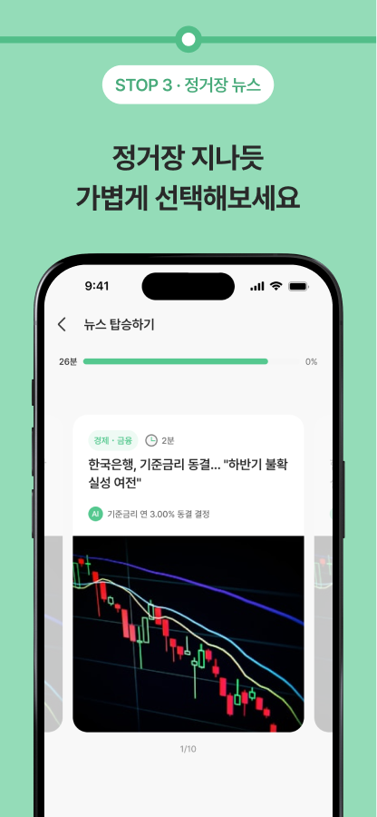
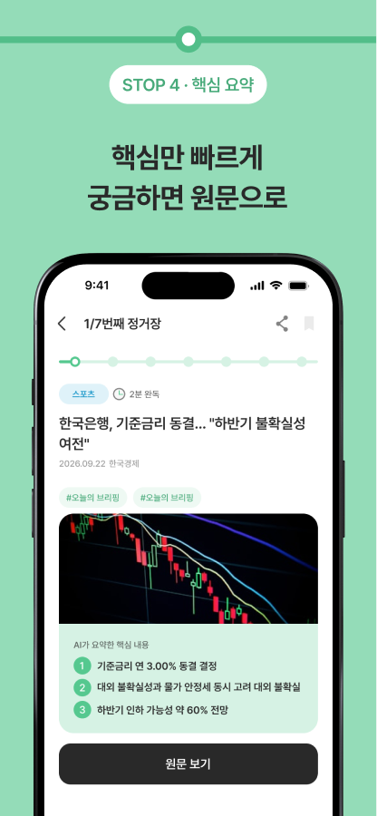
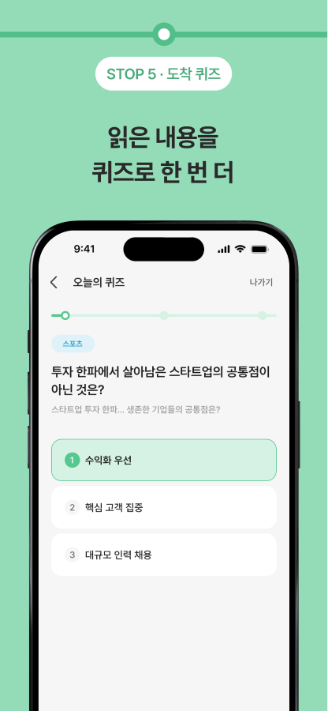
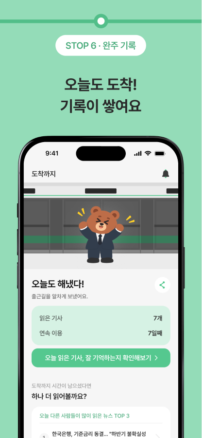
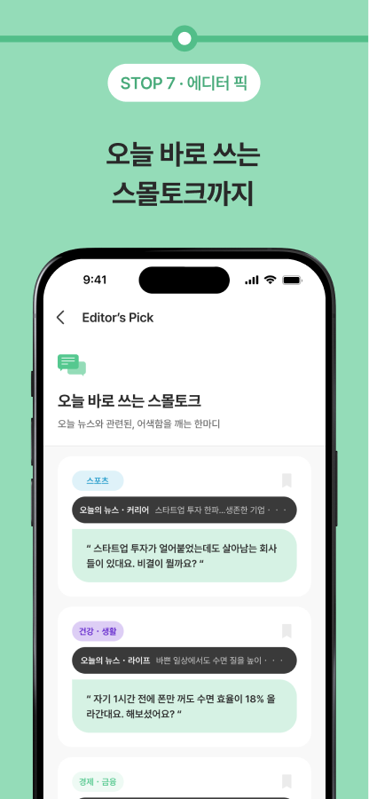
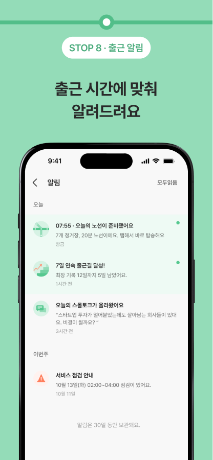
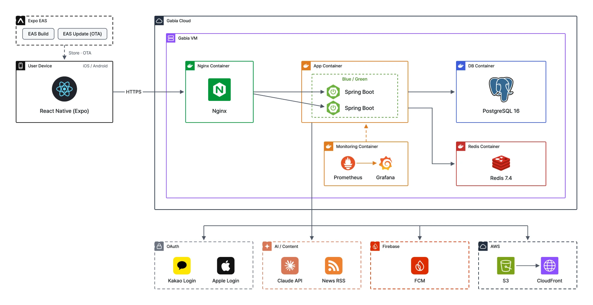

<div align="center">



# 도착까지 BYARRIVAL

**오늘의 출근길을 채우는 가장 가벼운 방법**

출근 시간과 컨디션에 맞춰 읽을 만큼만, 도착과 함께 끝나는 뉴스

KUSITMS 34th · TEAM K-PASS · Backend


</div>

<br />

## 서비스 소개

출퇴근 지하철에서 뉴스를 열면 끝까지 읽기 전에 내려야 하고, 무엇부터 읽을지 고르다 시간이 갑니다.
**도착까지**는 이동 시간과 오늘의 컨디션에 맞춰 뉴스 묶음, 즉 **노선**을 만들어 줍니다.
정거장을 지나듯 기사를 하나씩 넘기고, AI 3줄 요약으로 핵심만 읽고, 퀴즈로 한 번 더 기억합니다.
도착하면 오늘 읽은 기록이 쌓입니다.

<br />

## 주요 기능

<table>
  <tr>
    <td align="center" width="25%"></td>
    <td align="center" width="25%"></td>
    <td align="center" width="25%"></td>
    <td align="center" width="25%"></td>
  </tr>
  <tr>
    <td align="center"><b>출근길 설정</b><br />출근 시간과 이동 요일만 알려주세요</td>
    <td align="center"><b>오늘의 컨디션</b><br />컨디션에 맞춰 분량과 난이도가 달라져요</td>
    <td align="center"><b>정거장 뉴스</b><br />정거장 지나듯 가볍게 넘겨 읽어요</td>
    <td align="center"><b>핵심 요약</b><br />AI 3줄 요약, 궁금하면 원문으로</td>
  </tr>
  <tr>
    <td align="center"></td>
    <td align="center"></td>
    <td align="center"></td>
    <td align="center"></td>
  </tr>
  <tr>
    <td align="center"><b>도착 퀴즈</b><br />읽은 내용을 퀴즈로 한 번 더</td>
    <td align="center"><b>완주 기록</b><br />도착하면 스트릭과 기록이 쌓여요</td>
    <td align="center"><b>에디터 픽</b><br />오늘 바로 쓰는 스몰토크와 상식 용어</td>
    <td align="center"><b>출근 알림</b><br />출근 시간에 맞춰 알려드려요</td>
  </tr>
</table>

<br />

## 시스템 아키텍처



<br />

## 기술 스택

**Backend**

- Java 21
- Spring Boot 4.1.1
- Spring Web MVC - REST API
- Spring Security - 인증/인가
- Spring Data JPA - ORM
- Spring Validation - 요청 검증
- Spring Scheduling - 야간 수집 배치, 출근 알림, 데이터 파기

**Database & Storage**

- PostgreSQL 16
- Flyway - DB 마이그레이션
- Redis 7.4 - 캐시, 오늘 접속자 수, 후보 카드 위치
- AWS S3 + CloudFront - 프로필 이미지 저장·전송
- Thumbnailator - 프로필 이미지 축소·회전 보정

**인증 & 외부 연동**

- Kakao OAuth, Sign in with Apple
- JWT (Spring Security OAuth2 Resource Server)
- Firebase Admin SDK - FCM 푸시 알림
- Spring RestClient - 외부 API 호출

**AI & 콘텐츠**

- Anthropic Java SDK (Claude API) - 3줄 요약, 난이도 판정, 퀴즈, 스몰토크 생성
- Jsoup - RSS 파싱, 기사 본문 정제

**모니터링**

- Spring Boot Actuator
- Prometheus, Grafana, Alertmanager
- Discord Webhook - 서버 에러, 배치 결과 알림

**테스트 & 배포**

- JUnit 5, Testcontainers - PostgreSQL 통합 테스트
- k6 - 부하 테스트
- Docker Compose, Nginx - 블루/그린 무중단 배포
- GitHub Actions, GHCR - CI/CD

**API 문서**

- Springdoc OpenAPI / Swagger UI

<br />

## 핵심 설계

### 서비스일은 KST 04:00에 시작합니다

출근길에 이용하는 서비스 특성상, 자정을 기준으로 하루를 나누면 새벽에 귀가하는 사용자의 노선이 중간에 끊길 수 있습니다. 이를 방지하기 위해 서비스일을 오전 4시부터 다음 날 오전 3시 59분까지로 정의했습니다.

노선 생성, 스트릭 집계, 기사 노출 등 서비스의 모든 날짜 기준은 동일한 서비스일을 따릅니다.

### 노선은 서비스일마다 생성되는 스냅샷입니다

노선은 서비스일마다 한 번 생성되며, 생성 시점의 기사 목록과 순서, 난이도, 컨디션을 고정합니다. 이후 설정이 변경되더라도 이미 생성된 노선은 유지되며, 다음 서비스일이 시작되는 오전 4시에 완주 여부와 관계없이 만료됩니다.

이를 통해 하루 동안 일관된 학습 경험을 제공하고, 설정 변경으로 인한 노선의 예기치 않은 변경을 방지합니다.

### 수집부터 AI 가공까지, 하나의 배치로 처리합니다

매일 23:45에 기사 수집부터 AI 가공, 결과 검증 및 저장까지의 작업을 수행합니다. 새 서비스일이 시작되는 오전 4시에 해당 결과를 사용자에게 노출합니다.

```yaml
23:45  RSS 수집
       → 본문 정제
       → 동일 사건 기사 제외
       → 카테고리별 인기순 선별
       → AI 난이도 판정 · 3줄 요약 · 퀴즈 생성
       → 서버 검증 후 저장

04:00  새 서비스일 시작 및 기사 노출
```

- **AI 결과 검증:** AI 응답을 그대로 저장하지 않습니다. 응답 형식, 원문과의 일치 여부, 퀴즈 정답의 유일성 등을 서버에서 검증하며, 검증에 실패하면 재생성합니다.
- **배치 실패 대응:** 작업 실패 시 자동으로 재시도하며, 처리 결과와 실패 사유를 디스코드로 알립니다.
- **배포와 배치 간섭 방지:** 배포 스크립트는 배치 시간대인 23:30~00:30에 실행되지 않도록 제한했습니다. 이를 통해 배포로 인해 배치가 중복 실행되거나 처리 중단되는 상황을 방지합니다.

### 운영 상태를 관측하고 성능을 검증합니다

서비스의 안정적인 운영을 위해 메트릭 수집, 에러 알림, 부하 테스트를 구성했습니다.

- **메트릭 수집 및 모니터링:** Prometheus가 블루·그린 환경 양쪽의 메트릭을 수집하고, Grafana 대시보드에서 p95 응답 시간, 5xx 오류율, API별 지연 시간, DB 및 서버 자원 사용량, 백업 상태를 확인합니다.
- **에러 알림:** 처리되지 않은 500 에러를 디스코드로 알립니다. 동일한 에러는 5분에 한 번만 묶어서 전송해 알림이 과도하게 발생하지 않도록 했습니다.
- **부하 테스트:** k6로 회원 5,000명, 일일 노선 2,000건을 가정한 출근 시간대 부하를 재현하고, 변경 전후의 성능을 비교합니다.

성능 테스트 시나리오와 결과는 [`perf/README.md`](https://github.com/KUSITMS-BYARRIVAL/BYARRIVAL_BE/blob/dev/perf/README.md)에서 확인할 수 있습니다.

<br />

## 프로젝트 구조

```
src/main/java/com/byarrival/
  ByarrivalApplication.java
  common/                 # 공통 설정, 응답, 예외, JWT 보안, 서비스일(time), S3 저장소(storage), Discord 알림(monitoring)
  domain/
    admin/                # 어드민 인증, 피드·기사·에디터 픽·회원·알림 관리
    auth/                 # 카카오·Apple 로그인, 토큰 발급·갱신
    onboarding/           # 출근 시간·이동 요일·관심 카테고리 설정
    home/                 # 홈, 스트릭, 오늘 접속자 수
    route/                # 노선 생성·진행·이어보기·완주
    feed/                 # RSS 피드 관리, 수집
    article/              # 기사 정제·선별·조회
    ai/                   # Claude 클라이언트, AI 응답 검증
    batch/                # 야간 일일 배치, 자동 재시도
    quiz/                 # 퀴즈 생성·제출·채점
    smalltalk/            # 스몰토크
    term/                 # 상식 용어
    scrap/                # 보관함
    stat/                 # 이용 기록 통계
    notification/         # 출근 푸시 알림
    user/                 # 프로필, 개인 설정, 회원 탈퇴
    category/             # 뉴스 카테고리
    region/               # 시도·시군구 지역
    event/                # 앱 접속·이용 로그 기록과 파기

src/main/resources/
  application.yaml        # 공통 설정
  application-local.yaml  # 로컬 프로필 설정 (저장소에 포함하지 않음)
  application-prod.yaml   # 운영 프로필 설정
  db/migration/           # Flyway 마이그레이션
  prompts/                # AI 시스템 프롬프트 (요약, 난이도, 퀴즈, 퀴즈 검수, 스몰토크)

deploy/                   # 운영 Compose, 블루/그린 배포 스크립트, Nginx, 모니터링, DB 백업
perf/                     # k6 부하 테스트
.github/workflows/        # GitHub Actions (CI, 배포, Jira 연동, 업타임 체크)
```

<br />

## 실행 방법

요구 사항: JDK 21, Docker

```bash
docker compose up -d
```

로컬 PostgreSQL과 Redis를 띄웁니다.

```bash
./gradlew bootRun
```

기본 프로필은 `local`이며, `src/main/resources/application-local.yaml`에 로컬 설정이 필요합니다. 시크릿이 들어 있어 저장소에 포함하지 않으니 팀원에게 받습니다.

```bash
./gradlew build
```

컴파일과 테스트를 함께 실행합니다. 테스트는 Testcontainers로 DB를 띄우므로 Docker가 켜져 있어야 합니다.

운영 배포와 모니터링 절차는 [`deploy/README.md`](deploy/README.md)를 참고합니다.

<br />

## 협업 방식

- **이슈 → 브랜치 → PR**: 이슈 폼으로 이슈를 만들면 GitHub Actions가 Jira 하위 작업과 작업 브랜치를 함께 만들고, PR이 머지되면 하위 작업을 완료로 바꿉니다.
- **브랜치**: `dev`가 기본 브랜치입니다. 이름은 `<타입>/#<이슈번호>-<Jira 키>-<설명>` 형식입니다. 예: `feat/#12-DCK-40-route-create`
- **커밋**: `<타입>: <작업 내용>` 형식으로 씁니다. 타입은 `feat`, `fix`, `refactor`, `style`, `test`, `docs`, `chore`입니다.
- **리뷰**: PR마다 CI(빌드·테스트)와 CodeRabbit 리뷰를 거친 뒤 팀원이 머지합니다.

<br />

## 팀원

<table>
  <tr>
    <td align="center" width="160">
      <a href="https://github.com/lingard1234">
        <br />
        <b>고경수</b>
      </a><br />
      Backend
    </td>
    <td align="center" width="160">
      <a href="https://github.com/yunji1014">
        <br />
        <b>박윤지</b>
      </a><br />
      Backend
    </td>
  </tr>
</table>
